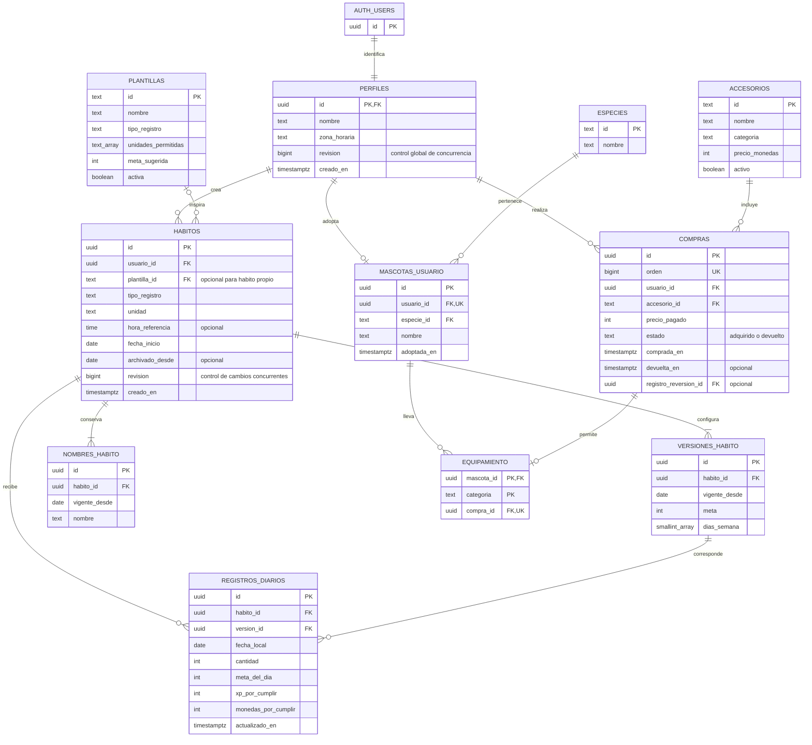

# Modelo propuesto de base de datos de Brotito

Modelo aprobado. Implementado en `supabase/migrations/202610200001_brotito.sql` y aplicado al proyecto de desarrollo el 20 de octubre de 2026. Los identificadores son UUID, excepto códigos de catálogos y secuencia de compras. `auth.users` es administrada por Supabase; no duplicamos contraseñas ni el correo de autenticación.

## Cómo se traduce en la aplicación

| Grupo | Responsabilidad |
| --- | --- |
| Cuenta y mascota | Perfil y zona horaria; una mascota como máximo por persona. El catálogo contiene Flori, Musguito, Seti, Lumi y Semillín. Una cuenta recién creada puede no haber elegido mascota aún. |
| Hábitos | Cada hábito conserva su tipo, unidad, inicio y archivo. La plantilla es opcional: un hábito propio no necesita una plantilla ficticia. Las sugerencias del catálogo no cambian los hábitos ya creados. |
| Cambios por fecha | Nombre y programación se versionan por separado: nombre hoy, meta y días mañana. La configuración inicial también es una versión. Se usa la última versión con fecha menor o igual al día consultado. |
| Registro diario | Una fila por hábito y fecha local. Guarda cantidad, meta y recompensa aplicable. La meta histórica no cambia al editar mañana. La versión referenciada debe pertenecer al mismo hábito. |
| Tienda y armario | Accesorios es el catálogo compartido; compras es la propiedad individual y conserva precio pagado y devoluciones. Equipamiento apunta a una compra vigente, no solo a un dibujo del catálogo. |

## Reglas que acompañarán las relaciones

1. `perfiles.id` referencia `auth.users.id`. Un perfil por cuenta; como máximo una mascota por perfil. La zona horaria inicial se conserva y no se cambia libremente en esta versión.
2. Combinaciones únicas: hábito + fecha en registros; hábito + fecha de vigencia en cada tabla de versiones; mascota + categoría en equipamiento. Una sola compra adquirida por usuario + accesorio mediante índice único parcial; se permiten varias compras devueltas y una recompra posterior.
3. Nombres de hábito de 1 a 60 caracteres, mascota de 1 a 30, unidad de 1 a 20. Cantidad entera no negativa; meta entera de 1 a 1000. Para sí/no, meta 1 y cantidad 0 o 1. Días únicos de 0 a 6, al menos uno. La fecha de registro respeta inicio y programación.
4. Completar genera 10 XP y 5 monedas por hábito/día. Los campos `xp_por_cumplir` y `monedas_por_cumplir` son fijados por servidor, no por el cliente. La recompensa efectiva es cero si cantidad < meta; al completar usa esos valores. Repetir la misma escritura no suma recompensas adicionales.
5. XP acumulada y monedas ganadas se calculan desde los registros completos; saldo = monedas ganadas − precios pagados de compras adquiridas. Etapa = umbral de XP (0/100/300/600). Rachas se calculan con programación y registros. No duplicamos estos totales como valores editables en perfil o mascota.
6. Corrección solo de hoy en la zona del usuario. En una transacción se actualiza el registro, se recalcula saldo y, si falta dinero, se devuelven compras adquiridas en orden descendente de `orden`, se indica el registro que provocó la devolución y se quita el equipo correspondiente. El orden único resuelve empates de hora. Recompensar de nuevo no recompra automáticamente.
7. Comprar, corregir y equipar bloquean la misma fila de perfil durante la operación para evitar gastar o devolver simultáneamente el mismo saldo. Precio, propiedad, fecha y permisos se validan en servidor; una clave pública no puede escribir directamente recompensas ni compras.
8. Editar conserva todas las versiones pasadas y reemplaza o elimina únicamente la pendiente de mañana. Antes del inicio se conserva una versión inicial para el primer día, aunque la nueva configuración tenga vigencia anterior al inicio.
9. Archivar establece la fecha local de hoy, cancela versiones futuras e impide nuevas escrituras de progreso desde ese momento. Los registros guardados antes del archivo, incluido el mismo día, siguen contando. No se borran compras ni recompensas.
10. Equipar exige compra adquirida del mismo usuario que la mascota y categoría coincidente con el catálogo. La combinación mascota + categoría limita a una pieza por categoría; distintas categorías pueden coexistir.
11. Las políticas por usuario protegen perfiles, mascotas, hábitos, versiones, registros, compras y equipamiento. Catálogos solo se leen desde la aplicación. Las relaciones de propietario y categoría requieren claves compuestas o validación transaccional adicional, no solo las flechas del dibujo.

## Alcance

No hace falta una tabla de calendario, tienda, inventario, etapa ni saldo: son vistas o cálculos sobre las tablas anteriores. Las ilustraciones siguen como recursos de la aplicación; no se guardan binarios en estas tablas.

Este modelo conserva el estado de los registros, no cada pulsación o corrección realizada. Un historial completo de auditoría sería una ampliación separada. Tampoco define todavía la eliminación de cuentas ni la importación de los datos locales: deben tener flujos explícitos antes de habilitarlos.

La revisión global en perfil complementa la revisión del hábito: invalida una confirmación si cambian compras, equipo u otro registro. El esquema remoto ya está aplicado; falta conectar las pantallas de cuenta y los datos de cada usuario.
